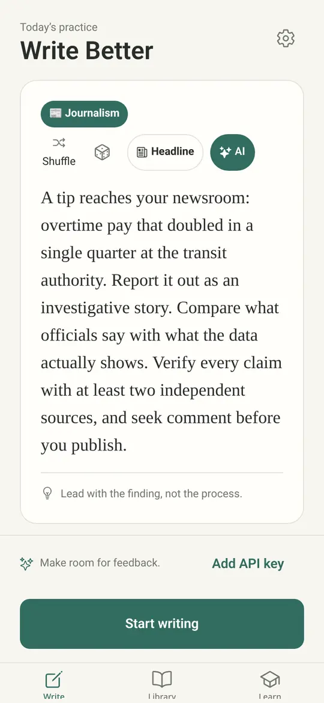
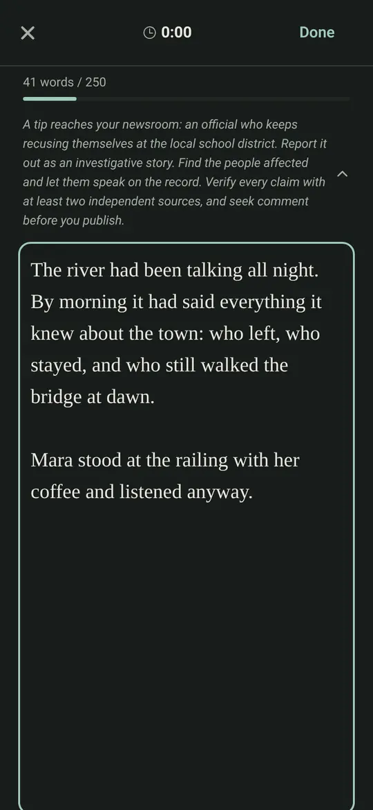
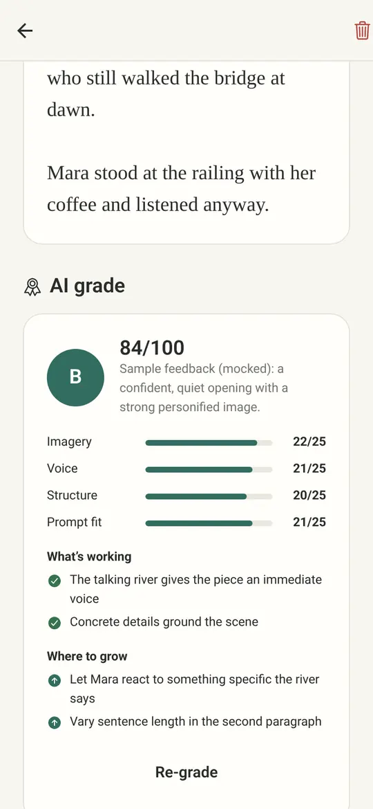
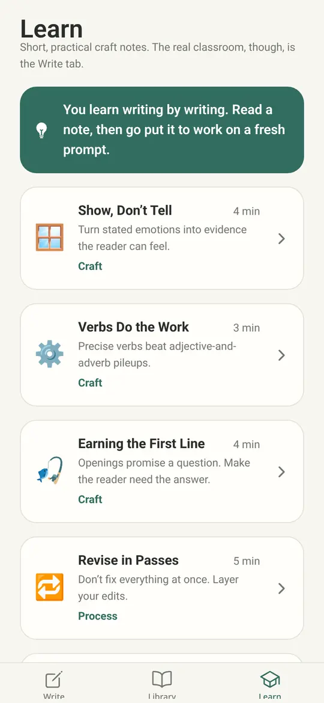
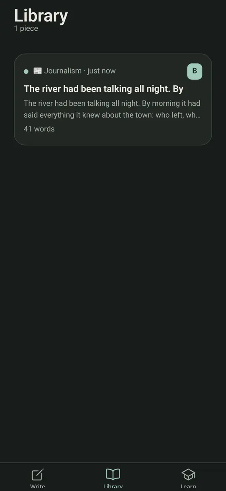
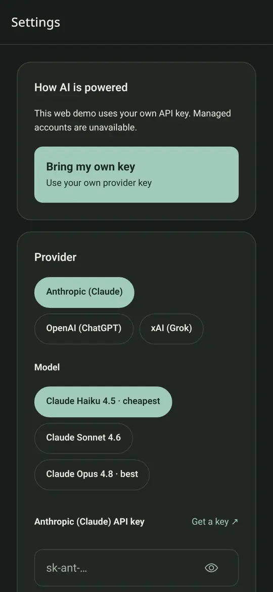

# Write Better

A small app for practicing writing: get a prompt, write against a timer, save the
piece, and (if you want) ask an AI model for feedback. It runs on iOS, Android,
and the web from one Expo codebase.

> **This is a personal project.** It works for me and is reasonably tested, but
> it hasn't been through a real release. Read [What's tested and what isn't](#whats-tested-and-what-isnt)
> before relying on it.

<p>
  
  
  
</p>
<p>
  
  
  
</p>

<sub>Screenshots come from the static web build and use sample text. The feedback shown is a mocked response, not real model output.</sub>

## What works

- **Prompts, offline.** Genre-aware prompts are assembled from a local pool of
  fragments across 13 genres, including Journalism and Personal. No network is needed.
- **Writing sessions.** A distraction-free editor with a word count, progress bar,
  and optional timer. Pieces are saved on the device (AsyncStorage, or
  localStorage on web).
- **Learn.** Short craft notes, plus an investigative journalism track.
- **AI feedback (optional).** Structured grades, line notes, a peer-review chat,
  and AI-tailored prompts. There are two ways to power it:
  - **Bring your own key (BYOK).** Paste an Anthropic, OpenAI, or xAI key in
    Settings and the app calls that provider directly.
  - **Managed account (native, or web with a server).** The [`server/`](server/)
    backend (Hono + SQLite + Stripe) holds the provider keys and handles
    authentication, metering, monthly quotas, and billing.
- **Journalism headlines.** The Headline button turns a current Hacker News
  front-page story (from the keyless Algolia API) into an investigative
  assignment. If the request fails, the app falls back to an offline prompt.
- **Light and dark themes, reduced motion, and screen-reader labels.** Animations
  use Reanimated and turn off when the OS asks for reduced motion.

Without a key, everything except the AI features works. AI buttons show an
"add your own key" state instead of failing.

## Where your API key is stored

BYOK keys used to live in AsyncStorage as plain text. They now go to
**`expo-secure-store` on iOS and Android** (Keychain and Keystore). On first
read the app migrates an old key, and it deletes the plaintext copy only after
the secure write succeeds.

**The web has no secure keystore**, so the web build keeps the key in
`localStorage`, which is unencrypted. Settings says so. Use a key with a spending
limit, and don't use the web demo on a shared computer.

Keys are only sent to the provider you pick. Never put a provider key in an
`EXPO_PUBLIC_*` variable, because those are compiled into the bundle.

## What's tested and what isn't

**Tested (runs in CI on every PR):**

- Lint (`expo lint`) and TypeScript for the app and the server.
- App unit tests (Vitest, 56 tests): the prompt generator, the provider layer
  (SDKs and `fetch` mocked), feedback parsing, BYOK key storage and migration,
  and demo-mode switching.
- Server tests (Vitest, 58 tests): auth, password hashing, rate limiting,
  quota reservation and metering, Stripe webhook signature checks (locally
  signed fixtures), and provider routing. SQLite runs in memory, and no real
  Stripe or AI calls are made.
- Web demo end-to-end (Playwright, 5 tests): prompts, sessions, the library,
  Learn, the no-key state, saving a key, mocked grading, and friendly errors for
  401, 429, and network failures. External traffic is blocked during these tests.
- Secret scanning (gitleaks) over the full history.

**Not tested, or only lightly:**

- **Native builds on real devices.** Native has been type-checked and
  unit-tested but hasn't been run on an iPhone or Android device, including the
  SecureStore migration.
- **Real AI providers.** The tests only use mocks. Model names and response
  shapes can drift, and browser CORS behavior differs between providers.
- **Live Stripe.** Only webhook verification and plan syncing are tested, with
  fake signed events. Checkout and the billing portal have never run against a
  real Stripe account.
- **Server deployment.** There's no production deployment, and things like
  SQLite backups and running multiple instances haven't been thought through.

See [TESTING.md](./TESTING.md) for details.

## Run it

```bash
npm install
npm run web      # browser (dev server)
npm run ios      # iOS simulator (needs Xcode)
npm run android  # Android emulator
```

Checks:

```bash
npm run lint && npx tsc --noEmit && npm test
cd server && npm install && npm run typecheck && npm test
```

Managed backend: `cd server && npm install && npm run dev`. See
[server/README.md](./server/README.md) and `server/.env.example`.

## Static web demo (BYOK only)

The web build can run with no backend at all. With no
`EXPO_PUBLIC_MANAGED_SERVER_URL` (or with `EXPO_PUBLIC_WEB_DEMO=true`), it hides
managed accounts and only offers BYOK.

```bash
EXPO_PUBLIC_WEB_DEMO=true npm run build:web   # outputs dist/
node scripts/serve-web.mjs                    # preview at http://127.0.0.1:4173
npm run e2e                                   # Playwright against dist/
```

### Hosting it for free

`dist/` is a plain static site, so any free static host will serve it. There is
no public demo today. A private Vercel project builds the BYOK demo for every
pull request (behind Vercel's deployment protection) using `vercel.json`:

- **Vercel:** `vercel.json` sets the build command
  (`EXPO_PUBLIC_WEB_DEMO=true npx expo export --platform web`), the output
  directory `dist`, clean URLs and the deep-link rewrites. Don't set any
  provider keys.
- **Cloudflare Pages:** use the same build command and output directory `dist`.

Deep links (`/piece/<id>`, `/learn/<id>`) need a fallback to the matching
exported `.html` file or `index.html`. `scripts/serve-web.mjs` shows the rules,
and both hosts support them through rewrites or `_redirects`. Keep in mind that
visitors who paste a key store it in their own browser's localStorage.

## Project layout

```
src/
  app/                 Expo Router routes: (tabs)/ Write · Library · Learn,
                       session, piece/[id], learn/[id], settings
  components/ui/       Button, Card, Chip, Dropdown, motion, empty/error/loading states
  constants/theme.ts   color, type, spacing, and radius tokens (light + dark)
  lib/                 no UI: prompts, genres, storage, key-store, providers,
                       ai (BYOK vs managed), api (backend client), news, demo
e2e/                   Playwright specs for the static web build
server/                managed backend (Hono + SQLite + Stripe)
docs/screenshots/      README images (WebP)
```

## Roadmap

See [ROADMAP.md](./ROADMAP.md).

## Security

Please report vulnerabilities privately; see [SECURITY.md](./SECURITY.md). Never
commit real API keys or `.env` files.

## License

[MIT](./LICENSE) © 2026 Ryan McGuiness. The project was bootstrapped from the
`create-expo-app` template (© 650 Industries, Inc., MIT).
